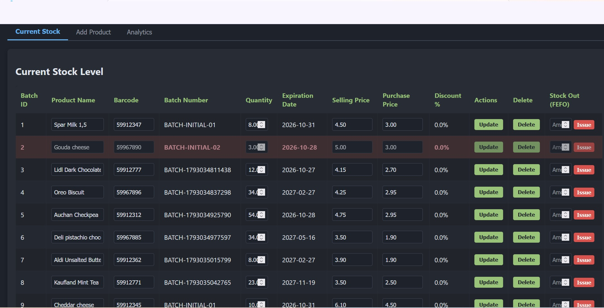

# Inventory Management

My project demonstrates practical experience in Java backend development, REST API design, software integration, database management, automated testing and cloud database migration.

## Technological Background

### Backend Architecture

- Java 21
- Spring Boot 3.4.0
- Spring Data JPA & Hibernate, Security
- REST API

### Frontend Architecture

- HTML5 
- CSS3 
- JavaScript (Vanilla JS)
- JSON

### Software Integration

The application follows an integration-oriented approach, using REST endpoints and asynchronous HTTP communication to connect its frontend and backend components.

Key integration concepts include:

- REST API communication and endpoint configuration.
- HTTP request and response handling.
- JSON-based data exchange.
- Frontend–backend integration.
- External service endpoint configuration.
- Separation of application components and responsibilities.

### Database & Cloud Technologies

The application was initially developed using PostgreSQL as its relational database. During development, a database migration was performed to move the application to Microsoft Azure SQL Database.The database is hosted on Microsoft Azure. The application source code and application deployment have not yet been hosted on Azure.

## Key Features

- Inventory Tracking: Monitor product quantities and inventory levels
- Batch Management: Organize inventory into batches and track expiration dates.
- Dynamic Pricing: Automatically calculate discounts based on product expiration dates.
- Low-Stock Alerts: Visually identify products that require restocking.
- Interactive Dashboard: Use multi-criteria sorting and an intuitive split-screen interface.
- Instant Quantity Adjustments: Update inventory quantities through a modal interface without reloading the page.
- Secure Access: Authentication and authorization using Spring Security.
- REST API Communication: Exchange application data through backend REST endpoints.

## Testing

The application includes automated tests covering backend functionality, REST API endpoints, database repositories, and security configurations.

- JUnit 5
- Mockito
- MockMvc
- Spring Security Testing
- JPA Repository Testing
- JaCoCo

## Screenshots

### Main Dashboard

### Inventory Management

### Swagger UI

## Project Status

The application is under active development, with ongoing improvements to backend functionality, testing, and integration capabilities.
