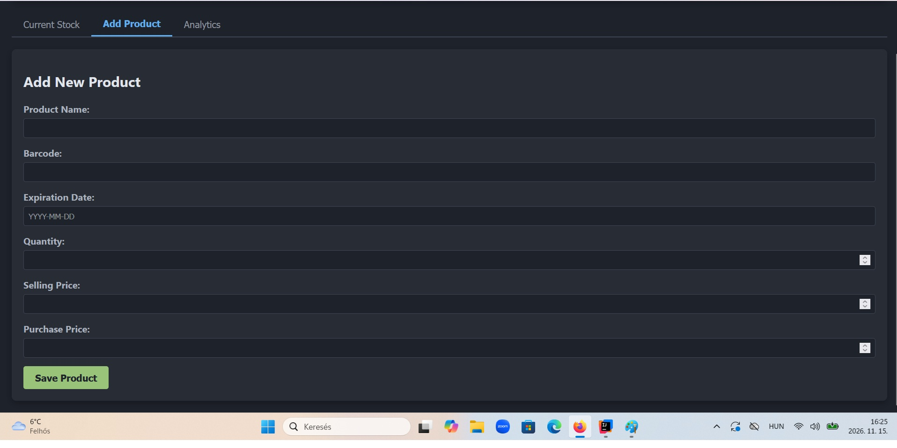
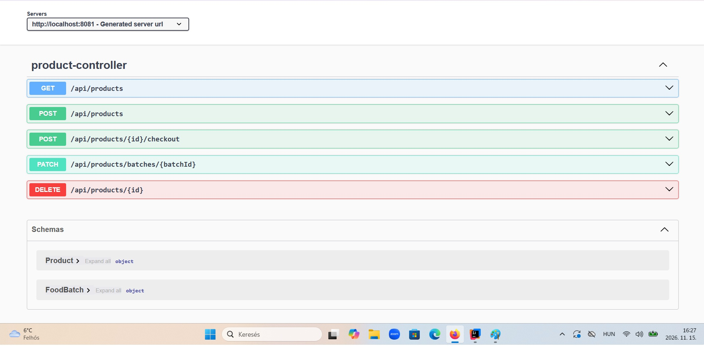

# Inventory Management

A clean and responsive web application for product inventory tracking. It features an intuitive split-screen dashboard backed by a relational database, supporting multi-criteria table sorting, smart batch grouping, low-stock visual alerts, and instant quantity adjustments through a pop-up modal interface.

The project demonstrates practical experience in Java backend development, REST API design, software integration, database management, automated testing, and cloud database migration.

---

## Technological Background

The application uses a decoupled architecture, separating the backend server from the asynchronous frontend interface.

### Backend Architecture

- **Java 21** – Core programming language.
- **Spring Boot 3.4.0** – Backend application framework.
- **Spring Data JPA & Hibernate** – Database access and object-relational mapping.
- **Spring Security** – Authentication and access control.
- **REST API** – Backend endpoints for application functionality and data exchange.

### Frontend Architecture

- **HTML5** – Application structure.
- **CSS3** – Responsive layout and styling.
- **JavaScript (Vanilla JS)** – Dynamic frontend functionality.
- **Fetch API** – Asynchronous HTTP communication with backend REST endpoints.
- **JSON** – Data exchange between frontend and backend components.

### Software Integration

The application follows an integration-oriented approach, using REST endpoints and asynchronous HTTP communication to connect its frontend and backend components.

The backend also includes configurable supplier API connectivity, allowing the supplier service endpoint to be managed through external application configuration. This provides a foundation for connecting external supplier services without hardcoding endpoint addresses.

Key integration concepts include:

- REST API communication and endpoint configuration.
- HTTP request and response handling.
- JSON-based data exchange.
- Frontend–backend integration.
- External service endpoint configuration.
- Separation of application components and responsibilities.

### Database & Cloud Technologies

The application was initially developed using **PostgreSQL** as its relational database. During development, a database migration was performed to move the application to **Microsoft Azure SQL Database**.

Spring Data JPA and Hibernate handle database persistence and interactions.

This provided practical experience with:

- PostgreSQL and Microsoft Azure SQL Database.
- Relational database migration.
- Database configuration and connectivity.
- ORM-based data persistence.
- Cloud-hosted database management.

The database is hosted on Microsoft Azure. The application source code and application deployment have not yet been hosted on Azure.

---

## Key Features

- **Inventory Tracking:** Monitor product quantities and inventory levels through a centralized dashboard.
- **Batch Management:** Organize inventory into batches and track expiration dates.
- **Dynamic Pricing:** Automatically calculate discounts based on product expiration dates.
- **Low-Stock Alerts:** Visually identify products that require restocking.
- **Interactive Dashboard:** Use multi-criteria sorting and an intuitive split-screen interface.
- **Instant Quantity Adjustments:** Update inventory quantities through a modal interface without reloading the page.
- **Secure Access:** Authentication and authorization using Spring Security.
- **REST API Communication:** Exchange application data through backend REST endpoints.

---

## Testing

The application includes automated tests covering backend functionality, REST API endpoints, database repositories, and security configurations.

Testing technologies and approaches:

- **JUnit 5** – Unit testing.
- **Mockito** – Dependency mocking and isolated service testing.
- **MockMvc** – REST controller and HTTP endpoint testing.
- **Spring Security Testing** – Authentication and authorization testing.
- **JPA Repository Testing** – Database persistence and query validation.

---

## Screenshots

### Main Dashboard

### Inventory Management

### Swagger UI

## Acknowledgements

Developed as a hands-on portfolio project to strengthen practical skills in Java backend development, Spring Boot, REST API design, software integration, HTTP communication, JSON data exchange, relational database management, database migration, frontend integration, software security, automated testing, and cloud database technologies.

